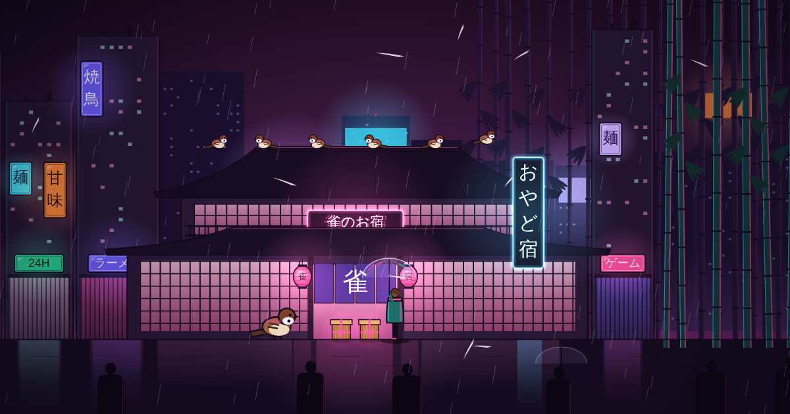

# Trick or Tsuzura 舌切り雀

A Halloween trick-or-treat for grown-ups, based on the Japanese folktale *Shita-kiri Suzume* (The Tongue-Cut Sparrow). A *tsuzura* (つづら) is the woven basket in the old story: one held treasure, one held monsters.



## How it plays

1. **Hear the story.** A cover page with little candy drawings, then a typed retelling of the folktale: the kind old man, the treasure, the greedy wife, the monsters, and the sparrow who still hides two baskets every Halloween.
2. **Explore.** Walk a small town at night, drawn in wobbly ink on paper, then leave through the north gate into the bamboo woods. Click or tap where you want to walk (or use the arrow keys). The story rides along: each line moves on as you keep walking, so nothing ever makes you stop and tap. The mist lifts and the lanterns wake wherever you go. A sparrow flies ahead to show the way, or you can let her lead with *Follow the sparrow*.
3. **Find four places.** The story is told by the crossroads, Lantern Lane, the edge of town, and the sparrow's den deep in the woods. A few hidden corners have their own small surprises.
4. **Pick.** At the den, two identical baskets wait. One holds a treat. The other holds something you will regret.
   - A treat lights up the whole town with fireworks and a flock of sparrows.
   - A trick kills every lantern, fills the screen with green stink and flies, and sends a laughing umbrella yokai to gloat.
5. **Pack.** Choose a treat and a trick for a friend, add a note, and tie the baskets. You get a link to send, and they go through the same town.

Treats are real pan-Asian candy: White Rabbit, Hi-Chew, Botan Rice Candy, Koala's March, Matcha KitKat, and Choco Pie. Tricks are not: smelly-foot gummies, booger jelly beans, dried squid taffy, pigeon-drop bonbons, earwax caramels, and garbage-day durian.

## How it works

It's a single static `index.html` with no build step, no backend, and no dependencies besides Google Fonts.

- The town is drawn on a `<canvas>` from code with a deliberately unsteady hand: every line wobbles and overshoots, fills sit slightly off their outlines, and a paper grain sits over everything. The wobble is seeded per object so drawings stay still as the camera moves. A low-resolution fog map tracks what you have uncovered.
- A gift is encoded into the link's hash (`#b.<base64url JSON>`), so nothing is stored anywhere. Share links are built from the page's own address, so they work wherever you host it.
- Sound (wind, chimes, footsteps, typing) is generated with Web Audio. It is on by default and starts on your first click, as browsers require.
- Motion is reduced when the visitor has `prefers-reduced-motion` turned on.

## Run it locally

Open `index.html` in a browser, or serve the folder:

```sh
python3 -m http.server 8000
```

## Publish with GitHub Pages

1. Push this repo to GitHub.
2. Go to **Settings → Pages**, set the source to **Deploy from a branch**, and pick `main` with the `/ (root)` folder.
3. Your site will be at `https://<your-username>.github.io/sparrows-baskets/`.

For the link preview image to show up in iMessage, WhatsApp, and similar apps, change `og:image` in `index.html` to the full address, for example `https://<your-username>.github.io/sparrows-baskets/og.png`.

## Customizing

- **Candy:** edit the `TREATS` and `TRICKS` arrays near the top of the script. Each entry has a name, origin, wrapper colors, a kanji for the wrapper, and a tasting note.
- **Places and story lines:** edit `PLACES`, `ROUTES` (the sparrow's path between places), and `WHISPERS` (hidden corners). The world is 1800 by 2400 units: the woods are the top 1050, the town is below.

## Credits

Based on 舌切り雀 (Shita-kiri Suzume), a traditional Japanese folktale.

Title lettering uses Nafta by [Krisjanis Mezulis](https://wildpicks.design/product/nafta-free-font/) (embedded in the page). Supporting text uses [Zen Kaku Gothic New](https://fonts.google.com/specimen/Zen+Kaku+Gothic+New), [IBM Plex Mono](https://fonts.google.com/specimen/IBM+Plex+Mono), [Fraunces](https://fonts.google.com/specimen/Fraunces) and [Shippori Mincho](https://fonts.google.com/specimen/Shippori+Mincho) from Google Fonts (SIL Open Font License).
